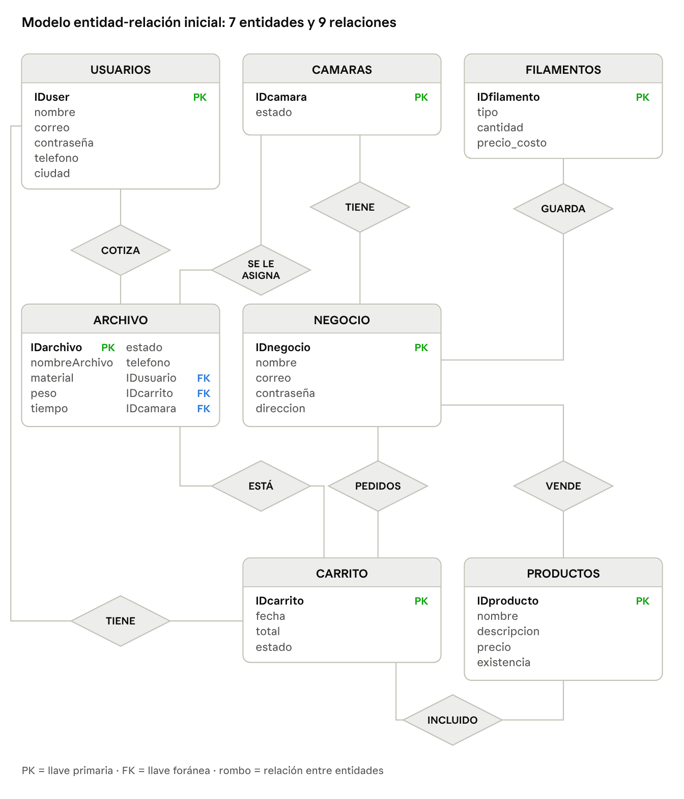
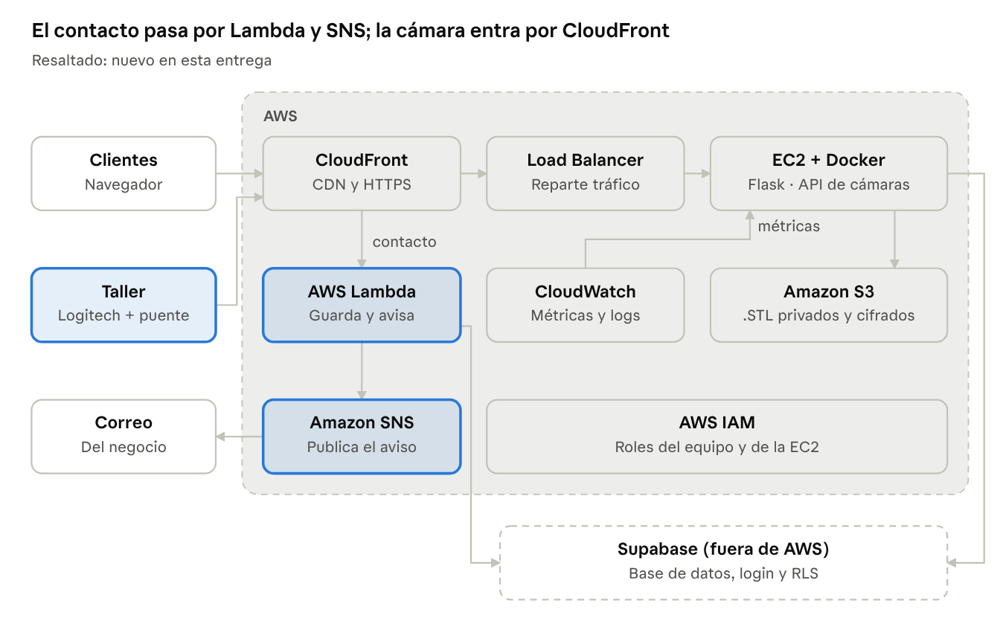
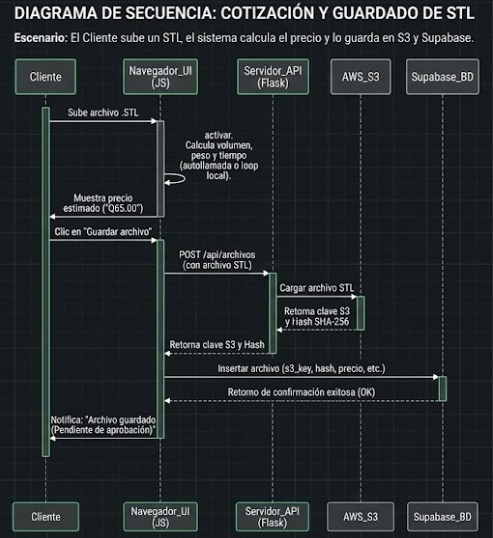
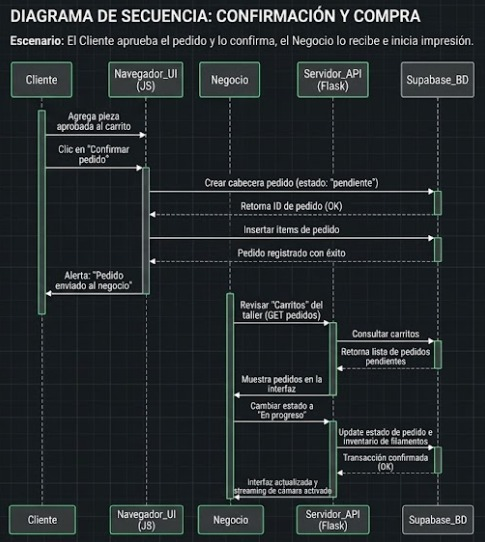
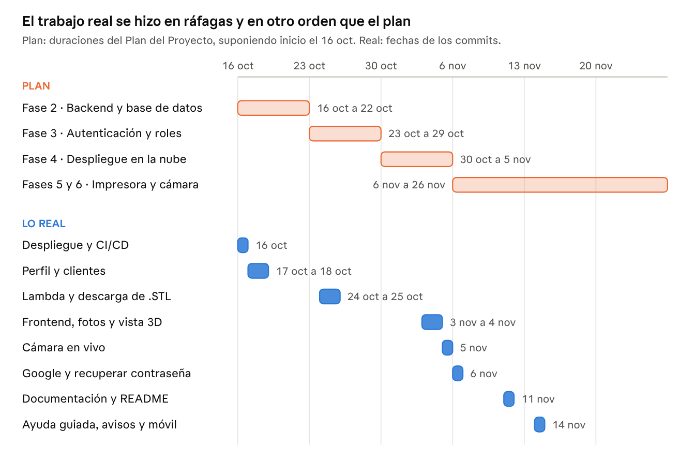

# Estudio 3D — Documentación final del proyecto

> Versión en PDF: [Documentacion_final.pdf](Documentacion_final.pdf)

Nov 11, 2026

## Datos del proyecto

|  |  |
| --- | --- |
| Proyecto | Estudio 3D: cotización de impresión 3D en la nube |
| Curso | Ingeniería de Software |
| Catedrático | Axel Benavides |
| Integrantes | Alan Martínez · 24000683 y Geovanni Ordoñez · 24001975 |
| Universidad | Universidad Galileo · FISICC · 2026 |
| App desplegada | [d3bvd36kte6l5e.cloudfront.net](https://d3bvd36kte6l5e.cloudfront.net) |

## El problema

En un negocio de impresión 3D como Estudio 3G, cada cotización se hace a mano, y cada cotización sin respuesta es una venta perdida.

- **Modelos infinitos.** Hay una infinidad de modelos 3D: ponerle un precio fijo a cada uno es imposible.
- **Cada pieza es nueva.** Hay que revisarla a mano para saber cuánto material gasta y cuántas horas tarda.
- **Clientes recurrentes.** Un ingeniero mecatrónico pide piezas seguido, y cada una es distinta.

Mientras el negocio calcula, el cliente dice «muy caro», «se tardó mucho» o deja de responder; y cuando el negocio crece, las cotizaciones se acumulan. Además, ya con el pedido hecho, el cliente no sabe qué pasa con su pieza hasta que se termina.

## La solución

Estudio 3D cotiza al instante: el cliente sube su archivo .STL y el navegador calcula volumen, peso del material y tiempo de impresión, y con las tarifas del negocio muestra el precio en quetzales y una vista 3D de la pieza.

| Lado | Qué puede hacer |
| --- | --- |
| Cliente | Cotizar un .STL, verlo en 3D, guardarlo, comprar en el catálogo con carrito, confirmar pedidos, ver su pieza imprimirse en vivo, contactar al negocio |
| Negocio | Aprobar o rechazar archivos con motivo, gestionar productos, tarifas, materiales, colores y filamento, llevar el estado de los pedidos, asignar cámaras |

**Antes y ahora**

| Paso | Antes | Ahora |
| --- | --- | --- |
| 1 | El cliente manda su pieza por mensaje | Sube su .STL a la app |
| 2 | El negocio la revisa a mano | La app calcula volumen, peso y tiempo |
| 3 | Calcula material y horas | El cliente ve el precio al instante |
| 4 | Por fin le da el precio, si el cliente aún responde | Confirma su pedido; el negocio aprueba en un clic |
| 5 | El cliente no sabe nada hasta que la pieza termina | Ve su pieza imprimirse en vivo |

## Resumen

Estudio 3D es la app web donde el cliente sube un archivo .STL, recibe el precio al instante y sigue su pedido hasta la impresión. Esta entrega agrega cuatro cosas: cámara en vivo, contacto con el negocio por AWS Lambda y Amazon SNS, inicio de sesión con Google y recuperación de contraseña.

| Función | Quién la usa | Dónde vive | Estado |
| --- | --- | --- | --- |
| Cámara en vivo | Cliente y negocio | EC2 (Flask) + puente en la PC del taller | Implementada y probada con la Logitech 720p |
| Contacto con el negocio | Cliente → negocio | AWS Lambda + Amazon SNS | Implementada |
| Iniciar sesión con Google | Cliente | Supabase Auth + Google Cloud (OAuth) | Código listo; falta activar Google en Supabase |
| ¿Olvidaste tu contraseña? | Cliente | Supabase Auth | Código listo; requiere un SMTP propio para clientes reales |
| Relación cámara → pieza | Base de datos | Supabase (`camaras.id_archivo` + RLS) | Aplicada |

Repositorio: [AlanMartinezzzz/estudio3d-backend](https://github.com/AlanMartinezzzz/estudio3d-backend). App publicada: [d3bvd36kte6l5e.cloudfront.net](https://d3bvd36kte6l5e.cloudfront.net).

## Enlaces de entrega

| Entregable | Enlace |
| --- | --- |
| App desplegada | [https://d3bvd36kte6l5e.cloudfront.net](https://d3bvd36kte6l5e.cloudfront.net) |
| Estado del servidor | [https://d3bvd36kte6l5e.cloudfront.net/health](https://d3bvd36kte6l5e.cloudfront.net/health) |
| Repositorio (README con diagrama, costos y despliegue) | [github.com/AlanMartinezzzz/estudio3d-backend](https://github.com/AlanMartinezzzz/estudio3d-backend) |

## Arquitectura

Los clientes entran por CloudFront y el Load Balancer a la app Flask en la EC2; lo nuevo es la entrada de la cámara desde el taller y el contacto por Lambda y SNS.

La EC2 guarda los .STL en S3 y lee y escribe en Supabase; Lambda guarda los mensajes en Supabase y publica en SNS, que manda el correo al negocio. GitHub Actions despliega cada push a `main` en la EC2.

## Estimación de costos

Operar Estudio 3D cuesta ≈ US$37 a 42 al mes (≈ Q285 a Q325 a Q7.7 por dólar), y el Load Balancer con sus IP es casi el 60 % de eso. Supuestos: región us-east-2 (Ohio), precios bajo demanda, 730 horas al mes, pocos usuarios, sin créditos ni capa gratuita de 12 meses.

| Servicio | Supuesto | USD al mes |
| --- | --- | --- |
| Load Balancer (ALB) | US$0.0225 por hora | 16.43 |
| Load Balancer: uso (LCU) | US$0.008 por LCU-hora, tráfico bajo | ≈ 1 – 6 |
| IPv4 públicas del ALB | 2 IP × US$0.005 por hora | 7.30 |
| EC2 | t3.micro, US$0.0104 por hora | 7.59 |
| IPv4 pública de la EC2 | 1 IP × US$0.005 por hora | 3.65 |
| Disco EBS | 8 GB gp3 × US$0.08 | 0.64 |
| Amazon S3 | unos pocos GB de .STL | < 0.10 |
| CloudFront | capa siempre gratis: 1 TB y 10 millones de solicitudes | 0.00 |
| AWS Lambda | capa gratis: 1 millón de ejecuciones | 0.00 |
| Amazon SNS | capa gratis: 1,000 correos | 0.00 |
| CloudWatch | métricas básicas | 0.00 |
| Supabase | plan Free: 500 MB, 50,000 usuarios activos | 0.00 |
| GitHub Actions | repositorio público | 0.00 |
| **Total** |  | **≈ 37 – 42** |

- Ahorro posible: con una sola EC2, CloudFront puede apuntar directo a la instancia sin Load Balancer; el total bajaría a ≈ US$12 al mes.
- La cámara gasta ≈ 0.7 GB por hora por cliente mirando; el 1 TB gratis de CloudFront cubre ≈ 1,400 horas de video al mes.
- Supabase Free pausa el proyecto tras 1 semana sin actividad; para producción, el plan Pro cuesta desde US$25 al mes.
- Pregunta abierta: confirmar el tipo de instancia EC2 (se supuso t3.micro).

Fuentes: [EC2 t3.micro](https://www.doit.com/compute/spot/us-east-2/t3.micro) · [Application Load Balancer](https://www.cloudzero.com/blog/aws-alb-pricing/) · [IPv4 pública](https://aws.amazon.com/blogs/aws/new-aws-public-ipv4-address-charge-public-ip-insights) · [CloudFront](https://aws.amazon.com/cloudfront/pricing/pay-as-you-go) · [Lambda y SNS](https://aws.amazon.com/free/serverless) · [Supabase](https://supabase.com/pricing.md)

## Cámara en vivo

El cliente ve su pieza imprimirse desde «Mis archivos», con cerca de 1 segundo de retraso, sin comprar equipo ni abrir puertos en el router.

**Cómo viaja la imagen**

1. Una webcam Logitech 720p, conectada por USB a la PC del taller, apunta a la impresora.
2. El puente `puente_camara/camara_puente.py` toma 2 fotos por segundo (JPEG, 1280×720, calidad 65) y las envía al servidor con una clave secreta.
3. El servidor Flask en la EC2 guarda solo la última foto de cada cámara, en memoria.
4. La página del cliente pide la foto unas 3 veces por segundo; si no hay una nueva, el servidor responde vacío (204) y no se gasta internet.

**Endpoints nuevos (app.py)**

| Método y ruta | Quién lo llama | Qué hace |
| --- | --- | --- |
| `POST /api/camaras/<id>/foto` | Puente del taller | Recibe un JPEG (máx. 2 MB); exige `CAMARA_TOKEN` |
| `GET /api/camaras/<id>/en-vivo?desde=N` | Cliente o negocio con sesión | Devuelve la última foto; 204 si no hay una nueva; 404 si no hay señal en 10 s |
| `GET /api/camaras/estado` | Panel del negocio | Dice qué cámaras están transmitiendo |

**En la app**

- Negocio, sección Cámaras: cada tarjeta muestra «● Transmitiendo» o «○ Sin señal», su ID, una lista para asignar la pieza aprobada que vigila y el botón Ver en vivo.
- Cliente, Mis archivos: aparece el botón rosado En vivo solo en la pieza que tiene una cámara asignada.
- El visor se pausa cuando la pestaña está oculta y avisa si la cámara deja de transmitir.

**Seguridad**

- Solo el puente con la clave `CAMARA_TOKEN` puede enviar fotos (comparación con `hmac.compare_digest`).
- Para ver una cámara, el servidor consulta Supabase con el token del usuario: por RLS, un cliente solo encuentra la cámara asignada a una pieza suya. El permiso se guarda 30 s para no consultar en cada foto.
- El `.bat` con la clave está en `.gitignore` y no se sube a GitHub.

**Archivos del puente** (carpeta `puente_camara/`): `camara_puente.py`, `iniciar_camara.bat` (doble clic para transmitir), `requirements.txt` (opencv-python, requests), `supabase_camaras.sql` y `LEEME.md`.

Limitación: las fotos viven en la memoria del servidor, así que funciona con 1 worker de gunicorn (como está hoy). Con más workers habría que guardarlas en Redis.

## Contacto con el negocio: Lambda + SNS

El formulario «Contactar al negocio» no pasa por la EC2: lo atiende una función de AWS Lambda que guarda el mensaje y avisa al negocio por correo con Amazon SNS.

1. El cliente escribe asunto (3 a 100 caracteres) y mensaje (10 a 1000), con su nombre y teléfono.
2. La app envía un `POST` a la URL de la función con el token de sesión de Supabase (`Authorization: Bearer …`).
3. Lambda revisa la sesión, frena a quien manda muchos mensajes seguidos (responde 429) y guarda el mensaje en `mensajes_contacto`.
4. Lambda publica el aviso en un tema de SNS, y SNS lo entrega por correo al negocio.

| Respuesta | Lo que ve el cliente |
| --- | --- |
| 200 | «Mensaje enviado. Te responderemos pronto.» |
| 401 | «Tu sesión venció. Inicia sesión de nuevo.» |
| 429 | «Enviaste varios mensajes seguidos. Intenta de nuevo en un rato.» |

Por qué así: Lambda solo corre cuando alguien escribe y no carga la EC2; SNS permite agregar más destinos (por ejemplo SMS) sin tocar la app. La URL de la función está en `CONTACTO_URL` dentro de `static/script.js`.

## Inicio de sesión con Google y recuperar contraseña

El cuadro de inicio de sesión ahora tiene el botón «Continuar con Google» y el enlace «¿Olvidaste tu contraseña?»; al volver desde el correo, la app pide la contraseña nueva antes de dejar entrar.

**Continuar con Google**

- Sirve para entrar y para crear cuenta: Supabase crea el usuario la primera vez.
- Llama a `supabase.auth.signInWithOAuth` con `provider: 'google'`, regreso a la misma página y `prompt: 'select_account'` para elegir cuenta.
- Google redirige a Supabase, y Supabase devuelve al usuario a la app ya con sesión.
- No usa una cuenta de servicio: Google exige un ID de cliente OAuth, que se crea gratis en Google Cloud sin cuenta de facturación.

**¿Olvidaste tu contraseña?**

1. El cliente da clic en el enlace; el cuadro cambia a «Recuperar contraseña» y pide solo el correo.
2. `resetPasswordForEmail` envía un enlace que regresa a la app. Por seguridad, el mensaje es el mismo exista o no la cuenta.
3. Al abrir el enlace, Supabase emite `PASSWORD_RECOVERY` y la app abre la ventana «Contraseña nueva» (mínimo 6 caracteres, escrita dos veces).
4. `updateUser({ password })` guarda la contraseña y la app entra según el rol.
5. Si cancela, se cierra la sesión temporal: nadie entra sin cambiar la contraseña.

También: si el enlace venció o ya se usó (`otp_expired`), la app lo avisa; y el botón «Cambiar contraseña» del perfil ahora también regresa a la app.

Archivos cambiados: `templates/index.html` (botones y ventana nueva), `static/script.js` (lógica) y `static/styles.css` (estilo del botón de Google).

## Ayuda al usuario y avisos

La app ahora guía a quien entra por primera vez y muestra los errores en avisos grandes que no desaparecen solos, para que el usuario siempre entienda qué pasó.

**Recorridos guiados**

- La primera vez que un cliente o el negocio entra, un recorrido de 9 pasos oscurece la pantalla, resalta cada sección del menú y explica para qué sirve.
- La primera vez que abre cada sección, un recorrido corto explica esa sección; por ejemplo, en Cotizar archivo: subir el .STL, material y color, relleno, cantidad y guardar.
- Ya vistos, no se repiten: se guardan por cuenta en el navegador.
- El botón «? Instrucciones», arriba a la derecha, vuelve a mostrar la ayuda de la sección actual, el recorrido general o todas las ayudas.

**Avisos grandes**

| Tipo | Cuándo sale | Cómo se ve |
| --- | --- | --- |
| Error | Algo falló: conexión, sesión vencida, no se pudo guardar | Aviso grande rosa, «Algo salió mal», se cierra a mano |
| Advertencia | El usuario rompió una regla: archivo muy grande, formato o datos faltantes | Aviso grande amarillo con un título claro, se cierra a mano |
| Éxito | Algo salió bien: agregado al carrito, archivo guardado | Mensaje pequeño que se va solo |

**Restricciones del cotizador**

| Regla | Mensaje que ve el cliente |
| --- | --- |
| Solo archivos .STL | «Formato no permitido», con el nombre del archivo que eligió |
| Máximo 50 MB | «Archivo demasiado grande», con cuánto pesa su archivo |
| La pieza mide entre 2 mm y 40 cm | «Modelo demasiado pequeño / grande», con su medida real |
| Archivo no vacío y con volumen cerrado | «Archivo vacío» o «Modelo con huecos» |
| Fotos de máximo 5 MB | «Foto demasiado grande» |

Las reglas también se ven siempre bajo la zona de carga: «Solo archivos .STL · máximo 50 MB · la pieza debe medir entre 2 mm y 40 cm». El servidor repite el límite de 50 MB (`MAX_CONTENT_LENGTH`).

**Catálogo en celular**

En el celular, la ventana del producto se aplastaba y recortaba la foto. Ahora es una columna con la foto completa arriba, sin recortar, y la información debajo.

## Diagramas UML

Dos diagramas de casos de uso (negocio y cliente) y dos de secuencia (cotizar y comprar) describen lo que hace cada actor y cómo se comunican el navegador, la API, S3 y Supabase.

### Casos de uso: negocio

Iniciar sesión incluye verificar el rol de negocio. Revisar archivos se extiende a descargar el STL desde AWS S3 o rechazarlo con un motivo; gestionar carritos se extiende a actualizar las existencias de filamento; en gestionar cámaras el negocio elige qué pieza ve el cliente en vivo.

### Casos de uso: cliente

Iniciar sesión se extiende a hacerlo con Google. Guardar un archivo cotizado incluye cotizarlo y validar el perfil, igual que confirmar un pedido. En «Mis archivos» puede borrar los rechazados, y en su perfil cambiar la contraseña o contactar al negocio.

### Secuencia: cotizar y guardar un .STL

El navegador calcula el precio; al guardar, la API sube el .STL cifrado a S3 y devuelve su clave y su huella SHA-256, y el navegador registra el archivo en Supabase como pendiente de aprobación.

### Secuencia: confirmar y empezar a imprimir

El navegador crea el pedido en Supabase como pendiente; el negocio lo ve en Carritos y, al pasarlo a «En progreso», la API actualiza el pedido y descuenta el filamento en una sola transacción, y se activa la cámara en vivo.

## Base de datos

El modelo pasó de 7 entidades en el entidad-relación inicial (Usuarios, Negocio, Archivo, Carrito, Productos, Cámaras, Filamentos) a 12 tablas en Supabase, más `auth.users` para el inicio de sesión.

Este es el modelo entidad-relación con el que empezó el proyecto; después se agregaron las tablas y campos de la tabla siguiente.

| Cambio | Tabla | Para qué |
| --- | --- | --- |
| Columna nueva `id_archivo → archivos` | `camaras` | Cada cámara apunta a la pieza que está imprimiendo |
| Regla RLS «cliente ve la camara de su pieza» | `camaras` | Un cliente solo puede leer la cámara de una pieza suya |
| Tabla nueva | `carrito_items` | Lo que lleva cada pedido: archivos o productos |
| Tabla nueva | `mensajes_contacto` | Mensajes que llegan por Lambda |
| Tablas nuevas | `configuracion`, `materiales`, `colores` | Tarifas del cotizador: precio por gramo y por hora, multiplicador por material, colores |
| Campos nuevos | `archivos` | `s3_key`, `hash_archivo`, `precio`, `color`, `motivo_rechazo` |
| Campo nuevo | `carritos` | `filamento_descontado` |

El SQL de la cámara está en `puente_camara/supabase_camaras.sql`; ya se ejecutó y RLS está activo en `camaras` (`relrowsecurity = true`).

## Configuración y despliegue

Cada push a `main` despliega solo con GitHub Actions; lo que no está en el código se configura una vez en estos lugares.

| Dónde | Qué se configura | Valor |
| --- | --- | --- |
| `.env` en la EC2 | `CAMARA_TOKEN` | Clave larga al azar (`secrets.token_urlsafe(32)`); la misma va en el `.bat` |
| `iniciar_camara.bat` (PC del taller) | `SERVIDOR`, `CAMARA_ID`, `CAMARA_TOKEN`, `--indice` | `https://d3bvd36kte6l5e.cloudfront.net`, el ID de la tarjeta en la app, la clave, el número de webcam (Logitech = 1) |
| Supabase → SQL Editor | `supabase_camaras.sql` | Columna `id_archivo` + regla RLS |
| Google Cloud → Google Auth Platform | Pantalla de consentimiento (Externo, publicada) + cliente «Aplicación web» | Origen: la URL de CloudFront. Redirección: el Callback URL de Supabase |
| Supabase → Sign In / Providers → Google | Enable + Client ID + Client Secret | Los dos valores del cliente de Google |
| Supabase → URL Configuration | Site URL y Redirect URLs | `https://d3bvd36kte6l5e.cloudfront.net` y la misma con `/**`; en local, la dirección local con `/**` |
| Supabase → Emails → SMTP Settings | Servicio de correo propio (por ejemplo Brevo) | Necesario para que el correo de recuperación llegue a clientes reales |

Reglas a recordar:

- El `CAMARA_ID` del `.bat` debe ser igual al ID de la tarjeta; si se borra una cámara, el ID nuevo es otro.
- Una cámara extra en la misma PC = otro `.bat` con su propio `CAMARA_ID` e `--indice`; todos los `iniciar_camara*.bat` están en `.gitignore`.
- El secreto de Google solo va en Supabase, nunca en el código.

## Pasos de despliegue

Desde cero, el despliegue toma 8 pasos; después, cada `git push origin main` actualiza la app sola.

1. **Supabase.** Crear el proyecto y las 12 tablas; ejecutar `puente_camara/supabase_camaras.sql`; en URL Configuration poner la URL de CloudFront como Site URL y como Redirect URL con `/**`; activar Google; conectar un SMTP propio.
2. **S3 e IAM.** Bucket privado con cifrado SSE-S3; rol de IAM para la EC2 con `s3:PutObject`, `s3:GetObject` y `s3:GetBucketLocation` solo sobre ese bucket.
3. **EC2.** Ubuntu en us-east-2 con ese rol; puerto 8080 abierto solo al Load Balancer; instalar Docker y git; clonar el repositorio en `~/estudio3d-backend`; crear `.env` con `SUPABASE_URL`, `SUPABASE_KEY`, `S3_BUCKET`, `AWS_REGION=us-east-2` y `CAMARA_TOKEN`.
4. **Load Balancer.** Grupo de destino HTTP 8080 con health check en `/health`; ALB en 2 zonas escuchando en el puerto 80.
5. **CloudFront.** Origen = el ALB; redirigir HTTP a HTTPS; permitir todos los métodos; reenviar el encabezado `Authorization`; no cachear `/api/*`.
6. **GitHub Actions.** Crear los secretos `EC2_SSH_KEY`, `EC2_HOST` y `EC2_USERNAME`. El flujo `deploy.yml` entra por SSH, hace `git pull`, `docker build` y `docker run --env-file .env -p 8080:8080`.
7. **Lambda + SNS.** Tema de SNS con el correo del negocio suscrito y confirmado; función Lambda con URL y permiso `sns:Publish`; su URL va en `CONTACTO_URL`.
8. **Cámara.** En la PC del taller, copiar `ejemplo_iniciar_camara.bat` como `iniciar_camara_logi.bat`, poner el ID de la tarjeta y la clave del `.env`, y abrirlo.

Comprobación: la pestaña Actions termina en verde y `/health` responde `{"status":"healthy"}`. El detalle completo está en el README del repositorio.

**Errores vistos y su arreglo**

| Síntoma | Causa | Arreglo |
| --- | --- | --- |
| `No module named 'cv2'` al abrir el `.bat` | OpenCV estaba solo en el `.venv` | El `.bat` corre `pip install -r requirements.txt` antes de transmitir |
| Se ve la cámara de la laptop | La Logitech es la webcam 1 | `--indice 1` en el `.bat` |
| La tarjeta dice «Sin señal» con el puente abierto | El `CAMARA_ID` no coincide con la tarjeta | Poner el ID que muestra la tarjeta |
| «El servidor rechazó la clave» | La clave del `.bat` y la del `.env` son distintas | Copiar la misma; reiniciar el contenedor si cambió el `.env` |
| `provider is not enabled` al usar Google | Google está apagado en Supabase | Sign In / Providers → Google → Enable + ID + Secreto → Save |
| El correo de recuperación no le llega a un cliente | El correo incluido en Supabase solo envía al equipo del proyecto, máx. 2 por hora | Configurar un SMTP propio |
| ¿Olvidaste tu contraseña? no hace nada | Falta el `script.js` nuevo | Reemplazar los tres archivos: HTML, CSS y JS |

## Plan original vs. lo realizado

No seguimos el plan al pie de la letra: el objetivo se cumplió (cotización automática, pedidos, inventario y una cámara en vivo), pero cambiamos la nube de Google Cloud a AWS con Supabase, desplegamos desde el primer día en vez de al final, y la conexión con la impresora y la detección de errores quedaron pendientes. Fuentes: el Plan del Proyecto y el Estudio de Factibilidad entregados antes, comparados con el historial de commits del repositorio.

**Por fase**

| Fase del plan | Entregable planeado | Lo que se hizo | Resultado |
| --- | --- | --- | --- |
| 1. Diseño | Modelo E/R y prototipo navegable | Modelo E/R de 7 entidades y prototipo de cliente y negocio | Cumplida antes del primer commit |
| 2. Backend y base de datos | API en Python con PostgreSQL | API en Flask con Supabase (PostgreSQL); el modelo creció de 7 a 12 tablas | Cumplida |
| 3. Autenticación y roles | Login diferenciado cliente/negocio | Login con roles, perfil de cliente; después se sumaron Google y «olvidé mi contraseña» | Cumplida y ampliada |
| 4. Despliegue en la nube | App en una URL pública en GCP | App en AWS (EC2, CloudFront, Load Balancer, S3) con despliegue automático por GitHub Actions | Cumplida, en otra nube y como primer paso |
| 5. Integración con impresora | Enviar trabajos de impresión desde la web | No se implementó | Pendiente |
| 6. Cámara y detección de errores | Alertas y pausa automática ante fallos (OpenCV, Pub/Sub) | Cámara en vivo para el cliente (OpenCV solo para capturar); sin detección ni pausa | Parcial |
| Fuera del plan | — | Contacto con Lambda + SNS, catálogo con fotos, vista 3D, ayuda guiada y avisos | Agregado |

**Tecnología: planeado vs. usado**

| Área | Plan (GCP) | Usado (AWS + Supabase) |
| --- | --- | --- |
| Cómputo | Cloud Run | EC2 con Docker |
| Base de datos | Cloud SQL o Supabase | Supabase |
| Archivos | Cloud Storage | Amazon S3 |
| Entrada y balanceo | Cloud Load Balancing | CloudFront + Application Load Balancer |
| Permisos | Cloud IAM | AWS IAM |
| Monitoreo | Cloud Monitoring/Logging | CloudWatch |
| Despliegue | Cloud Build | GitHub Actions |
| Mensajería | Pub/Sub (alertas de la cámara) | Lambda + SNS (avisos de contacto) |
| Autenticación | No definida | Supabase Auth con Google |

**Costos y hardware**

- Cámara: se planeó comprar una de Q150 a Q400; se usó una Logitech 720p que ya teníamos, sin costo.
- Nube: el plan pedía servicios gratuitos; la operación real cuesta ≈ US$37 a 42 al mes sin capa gratuita (ver Estimación de costos).

**Riesgos del plan: qué pasó**

| Riesgo planeado | ¿Ocurrió? | Qué hicimos |
| --- | --- | --- |
| Retraso con la impresora física | Sí | Seguimos el plan B: el sistema web avanzó sin la impresora; la integración quedó pendiente |
| Cotización distinta a la impresión real | Mitigado | Estados pendiente/aprobada/rechazada para que el negocio revise antes de imprimir |
| Agotar créditos gratuitos de la nube | En parte | El plan gratuito de AWS no permite comprar un dominio propio |
| Pérdida de datos de clientes | No | RLS en Supabase, S3 privado y cifrado, IAM de mínimo privilegio |
| Falsos positivos del detector de la cámara | No aplicó | La detección de errores no se llegó a construir |
| Coordinación del equipo | Sí | El trabajo se concentró en ráfagas, con pausas de hasta 8 días sin commits |

**Contra el estudio de factibilidad**

- El 80 % de los encuestados dijo que ver cómo avanza su pieza le daría confianza: la cámara en vivo responde a eso.
- En la matriz comparativa, «monitoreo por cámara» pasó de *Planeado* a *Sí, en vivo* (sin detección de errores); «conexión directa con la impresora» sigue *Planeada*.

## Calendarización: plan contra realidad

El plan daba 1 semana a cada fase, en orden (backend, autenticación, despliegue) y de 1 a 3 semanas a la impresora y la cámara: de 4 a 6 semanas en total. El trabajo real duró unas 4 semanas, del 16 oct al 14 nov, pero con commits en solo 11 de esos 30 días.

- **Otro orden.** El despliegue en la nube, planeado como fase 4, fue lo primero: el 16 oct ya había despliegue automático con GitHub Actions.
- **En ráfagas.** Hubo dos pausas largas sin commits: del 19 al 23 oct y del 26 oct al 2 nov (8 días).
- **La cámara antes que la impresora.** La cámara en vivo llegó el 5 nov, mientras que la conexión con la impresora sigue pendiente.
- **Trabajo no planeado.** Lambda para el contacto, el catálogo con fotos, la vista 3D, Google y la ayuda guiada no estaban en el calendario.

## Lo que falta

Hoy el pedido se confirma en la app, pero el cobro todavía no: falta el pago y todo lo que sigue a una venta en línea.

| Paso de la venta | Estado | Qué falta |
| --- | --- | --- |
| Carrito y pedido | Ya está | — |
| Método de pago | Falta | Tarjeta o transferencia con una pasarela de pago |
| Comprobante y factura | Falta | Confirmación del pago y factura electrónica (FEL) |
| Impresión en vivo | Ya está | — |
| Envío y seguimiento | Falta | Guía de envío y avisos al cliente |
| Entrega y postventa | Falta | Confirmar recibido, devoluciones y reseñas |

Otras mejoras pendientes:

- Conectar la impresora para mostrar avance, temperaturas y tiempo restante junto al video.
- Al terminar la impresión, apagar la cámara y pasar el pedido a «Terminado» solo.
- Aceptar archivos .OBJ además de .STL.
- Conectar un SMTP propio para que los correos de Supabase lleguen a cualquier cliente.
