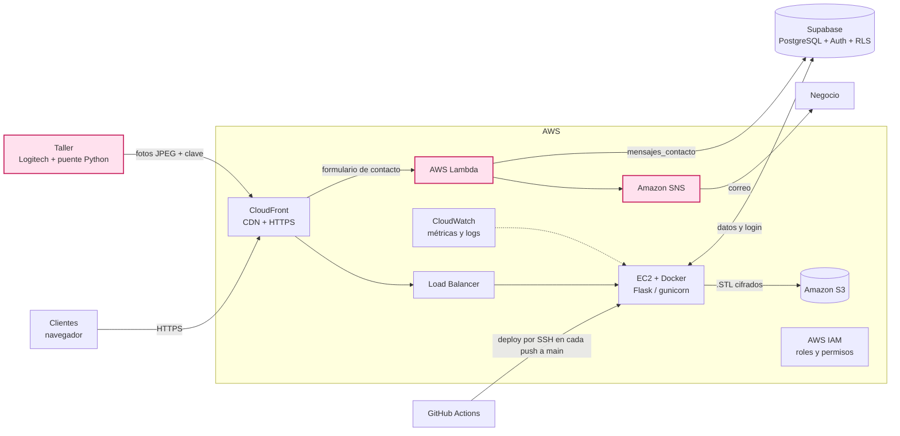

# Estudio 3D — Documentación de lo nuevo e implementado

**Ingeniería de Software · Universidad Galileo, FISICC · 2026**
Alan Martínez (24000683) · Geovanni (24001975) · Catedrático: Axel Benavides

## Resumen

Estudio 3D es la app web donde el cliente sube un archivo .STL, recibe el precio al instante y sigue su pedido hasta la impresión. Esta entrega agrega cuatro cosas: cámara en vivo, contacto con el negocio por AWS Lambda y Amazon SNS, inicio de sesión con Google y recuperación de contraseña.

| Función | Quién la usa | Dónde vive | Estado |
| --- | --- | --- | --- |
| Cámara en vivo | Cliente y negocio | EC2 (Flask) + puente en la PC del taller | Implementada y probada con la Logitech 720p |
| Contacto con el negocio | Cliente → negocio | AWS Lambda + Amazon SNS | Implementada |
| Iniciar sesión con Google | Cliente | Supabase Auth + Google Cloud (OAuth) | Código listo; falta activar Google en Supabase |
| ¿Olvidaste tu contraseña? | Cliente | Supabase Auth | Código listo; requiere un SMTP propio para clientes reales |
| Relación cámara → pieza | Base de datos | Supabase (`camaras.id_archivo` + RLS) | Aplicada |

## Enlaces de entrega

| Entregable | Enlace |
| --- | --- |
| App desplegada | <https://d3bvd36kte6l5e.cloudfront.net> |
| Estado del servidor | <https://d3bvd36kte6l5e.cloudfront.net/health> |
| Repositorio | [github.com/AlanMartinezzzz/estudio3d-backend](https://github.com/AlanMartinezzzz/estudio3d-backend) |

## Arquitectura

Los clientes entran por CloudFront y el Load Balancer a la app Flask en la EC2; lo nuevo es la entrada de la cámara desde el taller y el contacto por Lambda y SNS.



Imagen del diagrama: [docs/arquitectura.png](docs/arquitectura.png). En rosa, lo nuevo de esta entrega.

La EC2 guarda los .STL en S3 y lee y escribe en Supabase; Lambda guarda los mensajes en Supabase y publica en SNS, que manda el correo al negocio. GitHub Actions despliega cada push a `main` en la EC2.

## Estimación de costos

Operar Estudio 3D cuesta ≈ US$37 a 42 al mes (≈ Q285 a Q325 a Q7.7 por dólar), y el Load Balancer con sus IP es casi el 60 % de eso. Supuestos: región us-east-2 (Ohio), precios bajo demanda, 730 horas al mes, pocos usuarios, sin créditos ni capa gratuita de 12 meses.

| Servicio | Supuesto | USD al mes |
| --- | --- | --- |
| Load Balancer (ALB) | US$0.0225 por hora | 16.43 |
| Load Balancer: uso (LCU) | US$0.008 por LCU-hora, tráfico bajo | ≈ 1 – 6 |
| IPv4 públicas del ALB | 2 IP × US$0.005 por hora | 7.30 |
| EC2 | t3.micro, US$0.0104 por hora | 7.59 |
| IPv4 pública de la EC2 | 1 IP × US$0.005 por hora | 3.65 |
| Disco EBS | 8 GB gp3 × US$0.08 | 0.64 |
| Amazon S3 | unos pocos GB de .STL | < 0.10 |
| CloudFront | capa siempre gratis: 1 TB y 10 millones de solicitudes | 0.00 |
| AWS Lambda | capa gratis: 1 millón de ejecuciones | 0.00 |
| Amazon SNS | capa gratis: 1,000 correos | 0.00 |
| CloudWatch | métricas básicas | 0.00 |
| Supabase | plan Free: 500 MB, 50,000 usuarios activos | 0.00 |
| GitHub Actions | repositorio público | 0.00 |
| **Total** | | **≈ 37 – 42** |

- Ahorro posible: con una sola EC2, CloudFront puede apuntar directo a la instancia sin Load Balancer; el total bajaría a ≈ US$12 al mes.
- La cámara gasta ≈ 0.7 GB por hora por cliente mirando; el 1 TB gratis de CloudFront cubre ≈ 1,400 horas de video al mes.
- Supabase Free pausa el proyecto tras 1 semana sin actividad; para producción, el plan Pro cuesta desde US$25 al mes.
- Se supuso una EC2 t3.micro; si la instancia es otra, cambia esa fila.

Fuentes: [EC2 t3.micro](https://www.doit.com/compute/spot/us-east-2/t3.micro) · [Application Load Balancer](https://www.cloudzero.com/blog/aws-alb-pricing/) · [IPv4 pública](https://aws.amazon.com/blogs/aws/new-aws-public-ipv4-address-charge-public-ip-insights) · [CloudFront](https://aws.amazon.com/cloudfront/pricing/pay-as-you-go) · [Lambda y SNS](https://aws.amazon.com/free/serverless) · [Supabase](https://supabase.com/pricing.md)

## Cámara en vivo

El cliente ve su pieza imprimirse desde «Mis archivos», con cerca de 1 segundo de retraso, sin comprar equipo ni abrir puertos en el router.

**Cómo viaja la imagen**

1. Una webcam Logitech 720p, conectada por USB a la PC del taller, apunta a la impresora.
2. El puente `puente_camara/camara_puente.py` toma 2 fotos por segundo (JPEG, 1280×720, calidad 65) y las envía al servidor con una clave secreta.
3. El servidor Flask en la EC2 guarda solo la última foto de cada cámara, en memoria.
4. La página del cliente pide la foto unas 3 veces por segundo; si no hay una nueva, el servidor responde vacío (204) y no se gasta internet.

**Endpoints nuevos (app.py)**

| Método y ruta | Quién lo llama | Qué hace |
| --- | --- | --- |
| `POST /api/camaras/<id>/foto` | Puente del taller | Recibe un JPEG (máx. 2 MB); exige `CAMARA_TOKEN` |
| `GET /api/camaras/<id>/en-vivo?desde=N` | Cliente o negocio con sesión | Devuelve la última foto; 204 si no hay una nueva; 404 si no hay señal en 10 s |
| `GET /api/camaras/estado` | Panel del negocio | Dice qué cámaras están transmitiendo |

**En la app**

- Negocio, sección Cámaras: cada tarjeta muestra «● Transmitiendo» o «○ Sin señal», su ID, una lista para asignar la pieza aprobada que vigila y el botón Ver en vivo.
- Cliente, Mis archivos: aparece el botón rosado En vivo solo en la pieza que tiene una cámara asignada.
- El visor se pausa cuando la pestaña está oculta y avisa si la cámara deja de transmitir.

**Seguridad**

- Solo el puente con la clave `CAMARA_TOKEN` puede enviar fotos (comparación con `hmac.compare_digest`).
- Para ver una cámara, el servidor consulta Supabase con el token del usuario: por RLS, un cliente solo encuentra la cámara asignada a una pieza suya. El permiso se guarda 30 s para no consultar en cada foto.
- Los `iniciar_camara*.bat` con la clave están en `.gitignore` y no se suben a GitHub; en el repositorio solo está la plantilla `ejemplo_iniciar_camara.bat`.

**Archivos del puente** (carpeta `puente_camara/`): `camara_puente.py`, `ejemplo_iniciar_camara.bat` (plantilla para transmitir con doble clic), `requirements.txt` (opencv-python, requests), `supabase_camaras.sql` y `LEEME.md`.

Limitación: las fotos viven en la memoria del servidor, así que funciona con 1 worker de gunicorn (como está hoy). Con más workers habría que guardarlas en Redis.

## Contacto con el negocio: Lambda + SNS

El formulario «Contactar al negocio» no pasa por la EC2: lo atiende una función de AWS Lambda que guarda el mensaje y avisa al negocio por correo con Amazon SNS.

1. El cliente escribe asunto (3 a 100 caracteres) y mensaje (10 a 1000), con su nombre y teléfono.
2. La app envía un `POST` a la URL de la función con el token de sesión de Supabase (`Authorization: Bearer …`).
3. Lambda revisa la sesión, frena a quien manda muchos mensajes seguidos (responde 429) y guarda el mensaje en `mensajes_contacto`.
4. Lambda publica el aviso en un tema de SNS, y SNS lo entrega por correo al negocio.

| Respuesta | Lo que ve el cliente |
| --- | --- |
| 200 | «Mensaje enviado. Te responderemos pronto.» |
| 401 | «Tu sesión venció. Inicia sesión de nuevo.» |
| 429 | «Enviaste varios mensajes seguidos. Intenta de nuevo en un rato.» |

Por qué así: Lambda solo corre cuando alguien escribe y no carga la EC2; SNS permite agregar más destinos (por ejemplo SMS) sin tocar la app. La URL de la función está en `CONTACTO_URL` dentro de `static/script.js`.

## Inicio de sesión con Google y recuperar contraseña

El cuadro de inicio de sesión ahora tiene el botón «Continuar con Google» y el enlace «¿Olvidaste tu contraseña?»; al volver desde el correo, la app pide la contraseña nueva antes de dejar entrar.

**Continuar con Google**

- Sirve para entrar y para crear cuenta: Supabase crea el usuario la primera vez.
- Llama a `supabase.auth.signInWithOAuth` con `provider: 'google'`, regreso a la misma página y `prompt: 'select_account'` para elegir cuenta.
- Google redirige a Supabase, y Supabase devuelve al usuario a la app ya con sesión.
- No usa una cuenta de servicio: Google exige un ID de cliente OAuth, que se crea gratis en Google Cloud sin cuenta de facturación.

**¿Olvidaste tu contraseña?**

1. El cliente da clic en el enlace; el cuadro cambia a «Recuperar contraseña» y pide solo el correo.
2. `resetPasswordForEmail` envía un enlace que regresa a la app. Por seguridad, el mensaje es el mismo exista o no la cuenta.
3. Al abrir el enlace, Supabase emite `PASSWORD_RECOVERY` y la app abre la ventana «Contraseña nueva» (mínimo 6 caracteres, escrita dos veces).
4. `updateUser({ password })` guarda la contraseña y la app entra según el rol.
5. Si cancela, se cierra la sesión temporal: nadie entra sin cambiar la contraseña.

También: si el enlace venció o ya se usó (`otp_expired`), la app lo avisa; y el botón «Cambiar contraseña» del perfil ahora también regresa a la app.

Archivos cambiados: `templates/index.html` (botones y ventana nueva), `static/script.js` (lógica) y `static/styles.css` (estilo del botón de Google).

## Base de datos

El modelo pasó de 7 entidades en el entidad-relación inicial (Usuarios, Negocio, Archivo, Carrito, Productos, Cámaras, Filamentos) a 12 tablas en Supabase, más `auth.users` para el inicio de sesión.

| Cambio | Tabla | Para qué |
| --- | --- | --- |
| Columna nueva `id_archivo → archivos` | `camaras` | Cada cámara apunta a la pieza que está imprimiendo |
| Regla RLS «cliente ve la camara de su pieza» | `camaras` | Un cliente solo puede leer la cámara de una pieza suya |
| Tabla nueva | `carrito_items` | Lo que lleva cada pedido: archivos o productos |
| Tabla nueva | `mensajes_contacto` | Mensajes que llegan por Lambda |
| Tablas nuevas | `configuracion`, `materiales`, `colores` | Tarifas del cotizador: precio por gramo y por hora, multiplicador por material, colores |
| Campos nuevos | `archivos` | `s3_key`, `hash_archivo`, `precio`, `color`, `motivo_rechazo` |
| Campo nuevo | `carritos` | `filamento_descontado` |

El SQL de la cámara está en `puente_camara/supabase_camaras.sql`; ya se ejecutó y RLS está activo en `camaras` (`relrowsecurity = true`).

## Configuración

Cada push a `main` despliega solo con GitHub Actions; lo que no está en el código se configura una vez en estos lugares.

| Dónde | Qué se configura | Valor |
| --- | --- | --- |
| `.env` en la EC2 | `CAMARA_TOKEN` | Clave larga al azar (`secrets.token_urlsafe(32)`); la misma va en el `.bat` |
| `iniciar_camara_*.bat` (PC del taller) | `SERVIDOR`, `CAMARA_ID`, `CAMARA_TOKEN`, `--indice` | `https://d3bvd36kte6l5e.cloudfront.net`, el ID de la tarjeta en la app, la clave, el número de webcam (Logitech = 1) |
| Supabase → SQL Editor | `supabase_camaras.sql` | Columna `id_archivo` + regla RLS |
| Google Cloud → Google Auth Platform | Pantalla de consentimiento (Externo, publicada) + cliente «Aplicación web» | Origen: la URL de CloudFront. Redirección: el Callback URL de Supabase |
| Supabase → Sign In / Providers → Google | Enable + Client ID + Client Secret | Los dos valores del cliente de Google |
| Supabase → URL Configuration | Site URL y Redirect URLs | `https://d3bvd36kte6l5e.cloudfront.net` y la misma con `/**`; en local, la dirección local con `/**` |
| Supabase → Emails → SMTP Settings | Servicio de correo propio (por ejemplo Brevo) | Necesario para que el correo de recuperación llegue a clientes reales |

Reglas a recordar:

- El `CAMARA_ID` del `.bat` debe ser igual al ID de la tarjeta; si se borra una cámara, el ID nuevo es otro.
- Una cámara extra en la misma PC = otro `.bat` con su propio `CAMARA_ID` e `--indice`; todos los `iniciar_camara*.bat` están en `.gitignore`.
- El secreto de Google solo va en Supabase, nunca en el código.

## Pasos de despliegue

Desde cero, el despliegue toma 8 pasos; después, cada `git push origin main` actualiza la app sola.

1. **Supabase.** Crear el proyecto y las 12 tablas; ejecutar `puente_camara/supabase_camaras.sql`; en URL Configuration poner la URL de CloudFront como Site URL y como Redirect URL con `/**`; activar Google; conectar un SMTP propio.
2. **S3 e IAM.** Bucket privado con cifrado SSE-S3; rol de IAM para la EC2 con `s3:PutObject`, `s3:GetObject` y `s3:GetBucketLocation` solo sobre ese bucket.
3. **EC2.** Ubuntu en us-east-2 con ese rol; puerto 8080 abierto solo al Load Balancer; instalar Docker y git; clonar el repositorio en `~/estudio3d-backend`; crear `.env` con `SUPABASE_URL`, `SUPABASE_KEY`, `S3_BUCKET`, `AWS_REGION=us-east-2` y `CAMARA_TOKEN`.
4. **Load Balancer.** Grupo de destino HTTP 8080 con health check en `/health`; ALB en 2 zonas escuchando en el puerto 80.
5. **CloudFront.** Origen = el ALB; redirigir HTTP a HTTPS; permitir todos los métodos; reenviar el encabezado `Authorization`; no cachear `/api/*`.
6. **GitHub Actions.** Crear los secretos `EC2_SSH_KEY`, `EC2_HOST` y `EC2_USERNAME`. El flujo `deploy.yml` entra por SSH, hace `git pull`, `docker build` y `docker run --env-file .env -p 8080:8080`.
7. **Lambda + SNS.** Tema de SNS con el correo del negocio suscrito y confirmado; función Lambda con URL y permiso `sns:Publish`; su URL va en `CONTACTO_URL`.
8. **Cámara.** En la PC del taller, copiar `ejemplo_iniciar_camara.bat` como `iniciar_camara_logi.bat`, poner el ID de la tarjeta y la clave del `.env`, y abrirlo.

Comprobación: la pestaña Actions termina en verde y `/health` responde `{"status":"healthy"}`.

## Cómo probar y solución de problemas

**Pruebas**

- [ ] Cámara: abrir el `.bat`; en Cámaras la tarjeta pasa a «● Transmitiendo» en unos 15 s y Ver en vivo muestra la Logitech.
- [ ] Cámara para el cliente: asignar una pieza aprobada; en incógnito, el dueño ve el botón En vivo y otro cliente no.
- [ ] Contacto: enviar un mensaje; aparece en `mensajes_contacto` y llega el correo al negocio.
- [ ] Google: Continuar con Google en incógnito; regresa a la app ya con sesión.
- [ ] Recuperar contraseña: pedir el enlace, abrirlo, guardar la contraseña nueva y entrar con ella.

**Errores vistos y su arreglo**

| Síntoma | Causa | Arreglo |
| --- | --- | --- |
| `No module named 'cv2'` al abrir el `.bat` | OpenCV estaba solo en el `.venv` | El `.bat` corre `pip install -r requirements.txt` antes de transmitir |
| Se ve la cámara de la laptop | La Logitech es la webcam 1 | `--indice 1` en el `.bat` |
| La tarjeta dice «Sin señal» con el puente abierto | El `CAMARA_ID` no coincide con la tarjeta | Poner el ID que muestra la tarjeta |
| «El servidor rechazó la clave» | La clave del `.bat` y la del `.env` son distintas | Copiar la misma; volver a desplegar si cambió el `.env` |
| `provider is not enabled` al usar Google | Google está apagado en Supabase | Sign In / Providers → Google → Enable + ID + Secreto → Save |
| El correo de recuperación no le llega a un cliente | El correo incluido en Supabase solo envía al equipo del proyecto, máx. 2 por hora | Configurar un SMTP propio |
| ¿Olvidaste tu contraseña? no hace nada | Falta el `script.js` nuevo | Reemplazar los tres archivos: HTML, CSS y JS |

## Lo que falta

Hoy el pedido se confirma en la app, pero el cobro todavía no: falta el pago y todo lo que sigue a una venta en línea.

| Paso de la venta | Estado | Qué falta |
| --- | --- | --- |
| Carrito y pedido | Ya está | — |
| Método de pago | Falta | Tarjeta o transferencia con una pasarela de pago |
| Comprobante y factura | Falta | Confirmación del pago y factura electrónica (FEL) |
| Impresión en vivo | Ya está | — |
| Envío y seguimiento | Falta | Guía de envío y avisos al cliente |
| Entrega y postventa | Falta | Confirmar recibido, devoluciones y reseñas |

Otras mejoras pendientes:

- Conectar la impresora para mostrar avance, temperaturas y tiempo restante junto al video.
- Al terminar la impresión, apagar la cámara y pasar el pedido a «Terminado» solo.
- Aceptar archivos .OBJ además de .STL.
- Conectar un SMTP propio para que los correos de Supabase lleguen a cualquier cliente.

## Estructura del repositorio

```
app.py                  API Flask (cotización, archivos en S3, cámaras)
templates/index.html    Interfaz (cliente y negocio)
static/script.js        Lógica del frontend (Supabase, Google, cámara, contacto)
static/styles.css       Estilos
puente_camara/          Programa del taller que envía la cámara
docs/arquitectura.png   Diagrama de arquitectura
Dockerfile              Imagen de producción (gunicorn, 1 worker)
.github/workflows/      Despliegue automático a la EC2
```


